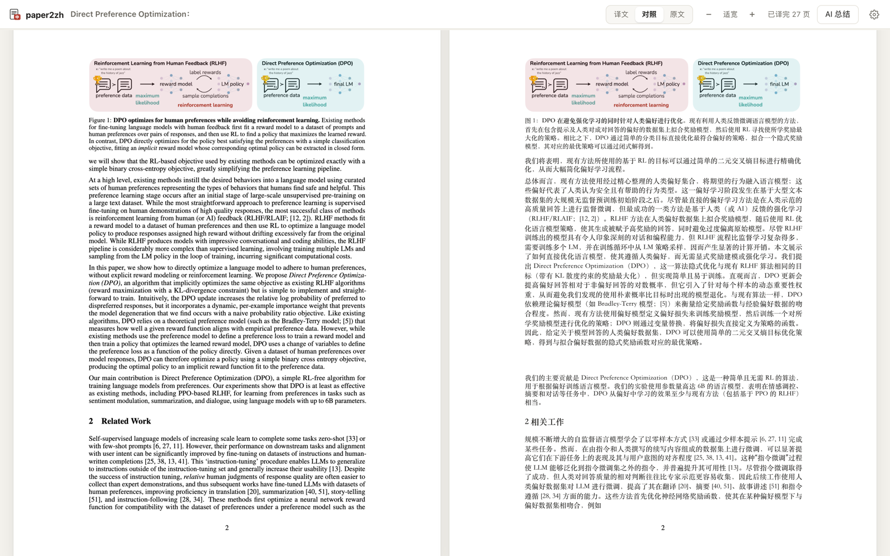
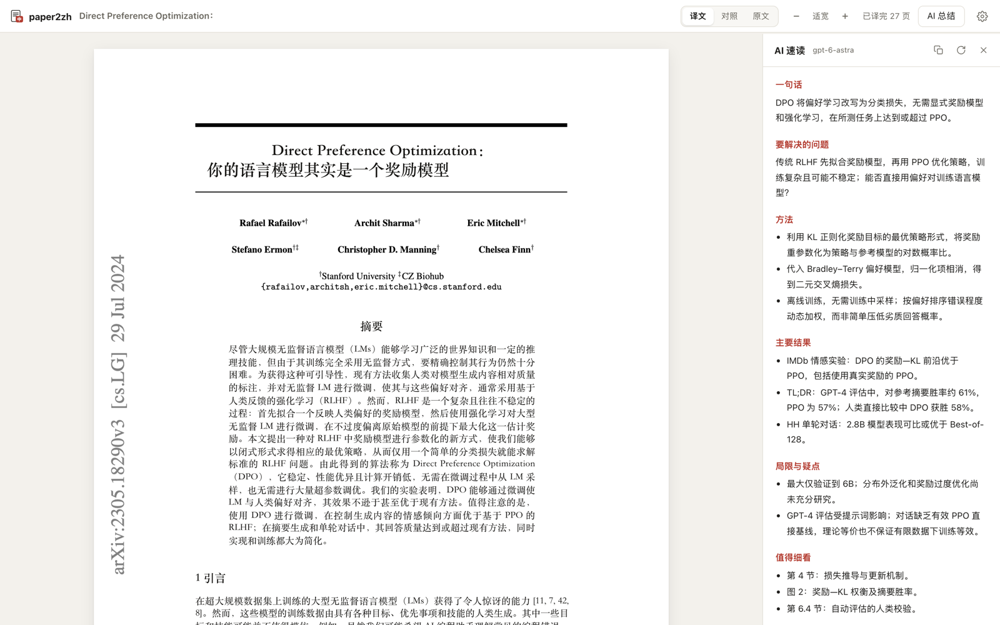

<p align="center"></p>

<h1 align="center">paper2zh</h1>

<p align="center">英文论文 PDF，一键变中文。图表、公式、版式原样保留，只替换正文；附 AI 速读总结。</p>

<p align="center"><a href="https://luojiaxuan.github.io/paper2zh/">在线使用</a> · <a href="https://github.com/luojiaxuan/paper2zh/releases/latest">下载 Chrome 扩展</a></p>



## 能做什么

- **原位替换**：逐页识别正文、标题、图注，在原来的位置排入中文。图片、表格、公式、代码、参考文献保持原样，读起来还是那篇论文。
- **公式、粗体、引用照原文**：段落里的行内公式直接用原页面上的字形，不经过翻译；独立成行的公式整块不动；粗体照原文加粗；引用缩成小号上标，括号保留，点开就是参考文献条目。
- **原文随时对照**：鼠标悬停任一段落看原文；可切换译文、左右对照、原文三种视图。
- **AI 速读**：一句话结论、问题、方法、关键数字、局限、最值得看的图表，几百字。
- **一键打开**：装上 Chrome 扩展后，在任意论文 PDF 页面（arXiv、OpenReview、会议官网）点工具栏图标即可。需要登录才能看的论文也行，扩展会用你在原站的登录状态取 PDF。
- **纯前端**：没有服务器。PDF 只在你的浏览器里解析，正文直接发给你选的翻译服务。翻译结果缓存在本机，重开同一篇不再花钱。



## 翻译服务

| 服务 | 需要 | 说明 |
|---|---|---|
| Google 翻译 | 无 | 默认，免费，可以先试试；没有 AI 总结 |
| Claude | Anthropic API Key | 默认 `claude-opus-5-5`，整篇想省钱可换 `claude-haiku-5-5` |
| DeepSeek | API Key | 中文好、便宜 |
| OpenAI / Gemini / OpenRouter | API Key | 填好 Key 后在设置里获取模型列表 |
| 其他 OpenAI 兼容接口 | 接口地址 | 例如本地 Ollama |

Key 只保存在你自己的浏览器（localStorage），请求从浏览器直接发往服务商。

## 安装扩展

1. 从 [Releases](https://github.com/luojiaxuan/paper2zh/releases/latest) 下载 `paper2zh-extension-*.zip` 并解压。
2. 打开 `chrome://extensions`，打开右上角“开发者模式”。
3. 点“加载已解压的扩展程序”，选择解压出的文件夹。

扩展安装时不要求“读取所有网站”的权限：只在你点击图标的那个标签页里取 PDF（activeTab）；少数取不到的情况，会先请你允许访问那一个网站。数据去向见[隐私说明](https://luojiaxuan.github.io/paper2zh/privacy.html)。本地 PDF 文件也想用扩展打开的话，在扩展详情里打开“允许访问文件网址”。不装扩展时，在[网页版](https://luojiaxuan.github.io/paper2zh/)拖入 PDF 或粘贴 arXiv 链接即可。

## 工作原理

1. 用 [pdf.js](https://github.com/mozilla/pdf.js) 取出每页文字的位置和字体，按行距、字号、缩进拼成段落；双栏、跨栏标题、行号、拉伸的两端对齐行都单独处理。
2. 嵌入的图片和 PDF 图形（`\includegraphics` 产生的 Form XObject）所占区域里的文字视为图内文字；成排对齐的短文本视为表格；等宽字体视为代码；参考文献标题之后、附录之前视为文献列表。这些都不翻译。
3. 按字体识别公式：数学字体（Computer Modern 的数学斜体、符号、扩展字体，AMS 字体等）连同其间的运算符、上下标算作一个行内公式；整行都是公式的行是独立公式，单独成块，不擦也不译。能在参考文献列表里查到的引用（`[12]`、`(Smith et al., 2020)`、`Smith et al. (2020)` 的年份）也单独标出。
4. 每页的正文块一次性交给翻译服务，行内公式和引用先换成占位符 `⟦n⟧`，粗体标成 `**…**`。译文回来后，公式贴回原页面上的字形（只取与无文字底图不同的像素，透明叠在中文上，能在 TeX 允许的运算符后换行），引用排成可点开的小号上标。
5. 译文页由两次渲染合成：先正常渲染，再渲染一张跳过文字绘制指令、也跳过段落内分数线等细线的版本，把要替换的段落区域从后者拷贝过来，背景、线条、色块都不受影响；再把中文按原框大小自动调字号排上去。

## 开发

```bash
npm install
npm run vendor        # 把 pdf.js、KaTeX、Anthropic SDK 打包进 app/vendor
python3 -m http.server 8765 -d app
node scripts/dump-layout.mjs paper.pdf 1 3   # 打印版面分析结果
```

`app/` 同时是 GitHub Pages 的站点目录和 Chrome 扩展目录，没有构建步骤。

## License

MIT。第三方组件的许可证见 `app/vendor/`。
